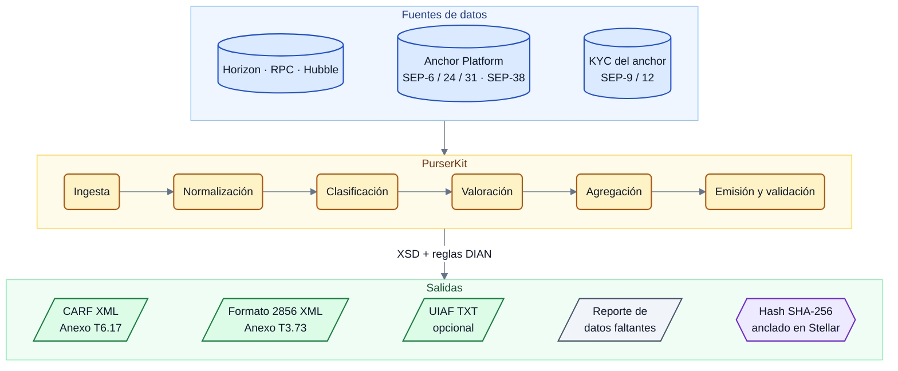

# PurserKit

<p align="center">
  
</p>

<p align="center">🌐 <a href="README.md">English</a> · <strong>Español</strong></p>

[](https://github.com/J4rias/PurserKit/actions/workflows/validate.yml)
[](LICENSE)

Herramienta de código abierto que convierte los datos de un proveedor de servicios de criptoactivos que opera sobre Stellar (historial de la red y registros del SDF Anchor Platform) en los reportes regulatorios que exigen la DIAN (Dirección de Impuestos y Aduanas Nacionales, la autoridad tributaria y aduanera de Colombia) y la UIAF (Unidad de Información y Análisis Financiero, la unidad de inteligencia financiera de Colombia).

> El *purser* es el oficial de un barco responsable de las cuentas, los registros y las declaraciones ante las autoridades portuarias. PurserKit cumple esa función para un anchor de Stellar.

> [!NOTE]
> **Estado: prototipo.** Los ejemplos incluidos validan contra los esquemas oficiales; la librería y la CLI están en desarrollo. Todos los documentos del repositorio están en inglés y en español; use el selector 🌐 al inicio de cada archivo.

---

## Índice

1. [Qué reportes cubre](#qué-reportes-cubre)
2. [Por qué existe](#por-qué-existe)
3. [Cómo funciona](#cómo-funciona)
4. [Contenido del repositorio](#contenido-del-repositorio)
5. [Inicio rápido](#inicio-rápido)
6. [Modelo de datos](#modelo-de-datos)
7. [Clasificación de activos](#clasificación-de-activos)
8. [Fuentes de datos y retención](#fuentes-de-datos-y-retención)
9. [Hoja de ruta](#hoja-de-ruta)
10. [Fuera de alcance](#fuera-de-alcance)
11. [Privacidad y seguridad](#privacidad-y-seguridad)
12. [Contribuir](#contribuir)
13. [Aviso](#aviso)
14. [Licencia](#licencia)

---

## Qué reportes cubre

| Reporte | Norma | Formato | Periodicidad | Primer vencimiento |
|---|---|---|---|---|
| **CARF** (intercambio automático de información sobre criptoactivos, estándar OCDE) | Res. DIAN 000240 de 2025, Anexo Técnico T6.17 "CARF XML v1.5" | XML UTF-8, esquema OCDE v1.5, un archivo por jurisdicción | Anual | 31 de mayo de 2027 (año gravable 2026) |
| **Formato 2856** — Reporte de operaciones con activos digitales (información exógena) | Res. DIAN 000233 de 2025, art. 1.3.12.21, Anexo Técnico T3.73 | XML ISO-8859-1, esquema propio de la DIAN, máximo 5.000 registros por archivo | Anual | Plazos de exógena 2027 (año gravable 2026) |
| **UIAF** — reportes de transacciones y de clientes para PSAV *(objetivo adicional)* | Res. UIAF 314 de 2021 y anexos técnicos vigentes | TXT delimitado por `\|`, ANSI CP1252 | Mensual (días 1 a 20) | En vigor desde julio de 2022 |

El detalle de cada obligación está en [`docs/legal-framework.es.md`](docs/legal-framework.es.md) y la especificación del Formato 2856 en [`docs/formato-2856.es.md`](docs/formato-2856.es.md).

## Por qué existe

- Los dos reportes de la DIAN cubren el mismo año gravable con esquemas distintos. Generarlos desde una sola fuente de datos evita inconsistencias entre ellos.
- El SDF Anchor Platform registra las transacciones SEP-6, SEP-24 y SEP-31, pero no persiste los datos de identificación de los clientes (que viven en el servidor del anchor vía SEP-12) ni ofrece exportación de reportes regulatorios.
- El estándar de campos KYC de Stellar (SEP-9) no contempla residencia fiscal, múltiples números de identificación tributaria ni autocertificación, datos que CARF exige.
- Un archivo con errores o que no corresponda a lo solicitado da lugar a las sanciones del artículo 651 del Estatuto Tributario (hasta 7.500 UVT).
- Las herramientas comerciales de reporte CARF no cubren los formatos colombianos ni confirman soporte para Stellar.

## Cómo funciona



1. **Ingesta.** Lee las tablas del Anchor Platform (`sep6_transaction`, `sep24_transaction`, `sep31_transaction`, `exchange_quote`), el KYC del anchor (campos SEP-9) y el historial on-chain (Horizon para datos recientes; eventos CAP-67 vía RPC; Galexie o Hubble para históricos).
2. **Normalización.** Cada movimiento se convierte en un evento reportable: usuario, activo, unidades, dirección (entrada/salida), tipo de contraparte, monto fiat si existe, fecha y referencia de origen.
3. **Clasificación.** Una tabla de reglas asigna cada evento a una categoría CARF (fiat↔cripto, cripto↔cripto, transferencias por tipo, transferencias a billeteras no custodiadas, pagos minoristas) y a un tipo de operación del Formato 2856. Ver [`docs/stellar-carf-mapping.es.md`](docs/stellar-carf-mapping.es.md).
4. **Valoración.** Precio en el momento de la operación con este orden de prioridad: cotización SEP-38 del propio anchor, precio del DEX de Stellar, agregador externo. La conversión a COP usa la TRM oficial publicada en datos.gov.co. Cada precio usado queda registrado para auditoría.
5. **Agregación.** Totales por usuario × activo × categoría, como exigen ambos formatos.
6. **Emisión y validación.** Se generan los XML y se validan contra los XSD oficiales y las reglas adicionales de la DIAN (longitud de identificadores, NIT sin dígito de verificación, decimales, codificación, partición de archivos). Se soportan correcciones y eliminaciones (CARF702) y el reporte en cero (CARF703).
7. **Auditoría on-chain.** El hash SHA-256 de cada archivo generado se ancla en Stellar mediante `manage_data` en la cuenta del proveedor, de modo que puede probarse qué archivo se preparó y cuándo, sin exponer su contenido.
8. **Reporte de datos faltantes.** Antes de emitir, se listan los usuarios sin número de identificación tributaria, sin residencia fiscal o sin autocertificación, para que el área de cumplimiento los complete.

## Contenido del repositorio

| Ruta | Contenido |
|---|---|
| `prototype/proto.py` | Prototipo de solo lectura: consulta cuentas públicas de mainnet vía Horizon, clasifica las operaciones en categorías CARF, las valora en COP con la TRM y emite XML con identidades sintéticas. |
| `examples/carf_proto_COP.xml` | Reporte CARF de ejemplo valorado en COP, generado por el prototipo. Valida contra el XSD oficial. |
| `examples/carf_proto_USD.xml` | Mismo reporte valorado en USD. |
| `examples/carf_nil_CARF703.xml` | Reporte en cero (CARF703) con los identificadores en el formato que exige la DIAN. |
| `schemas/dian-t6.17-carf-v1.5/` | XSD del Anexo T6.17 (`CARFXML_v1.5.xsd`, `oecdcarftypes_v5.0.xsd`, `isocarftypes_v1.1.xsd`) y su procedencia. |
| `schemas/dian-t3.73-formato-2856/` | Procedencia del XSD del Formato 2856 (pendiente de extraer del anexo). |
| `docs/legal-framework.es.md` | Resumen de las obligaciones DIAN y UIAF. |
| `docs/stellar-carf-mapping.es.md` | Tabla de correspondencia entre operaciones y eventos de Stellar y las categorías CARF. |
| `docs/formato-2856.es.md` | Especificación resumida del Formato 2856 y su mapeo desde el modelo de datos. |
| `tests/README.es.md` | Casos de prueba previstos para ambos esquemas. |
| `.github/workflows/validate.yml` | Integración continua: valida los ejemplos contra el XSD en cada push. |

## Inicio rápido

Requisitos: Python 3.10 o superior, `libxml2-utils` (para `xmllint`).

```bash
# 1. Validar los ejemplos contra el esquema oficial
xmllint --noout --schema schemas/dian-t6.17-carf-v1.5/CARFXML_v1.5.xsd examples/*.xml

# 2. Instalar dependencias del prototipo
python3 -m venv .venv && source .venv/bin/activate
pip install lxml

# 3. Ejecutar el prototipo (solo APIs públicas, sin credenciales)
cd prototype
python3 proto.py
```

El prototipo escribe `carf_proto_COP.xml`, `carf_proto_USD.xml` y `events_sample.json` en el directorio actual e imprime, por cuenta, el número de operaciones clasificadas, los totales por categoría y el resultado de las reglas de la DIAN.

## Modelo de datos

El elemento central es el **evento reportable**:

| Campo | Descripción |
|---|---|
| `user_id` | Identificador del cliente en el sistema del anchor (clave de unión con el KYC) |
| `asset` | Código y emisor del activo (`USDC:GA5Z…`, `native`, contrato SAC) |
| `units` | Cantidad en unidades del activo (hasta 7 decimales) |
| `direction` | `in` / `out` respecto del usuario |
| `counterparty_type` | `self`, `vasp`, `unhosted`, `issuer`, `unknown` |
| `fiat_leg` | Monto y moneda fiat cuando la operación tiene lado fiat (depósitos y retiros) |
| `ts` | Marca de tiempo del cierre del ledger o de la transacción del anchor |
| `source_ref` | Hash de transacción, identificador de la transacción SEP o número de ledger |

A partir de este evento se calculan las categorías CARF (`CryptoFiatIn/Out`, `CryptoToCryptoIn/Out`, `CryptoTransferIn/Out` con sus tipos, `TransferWallet`, `RRPT`) y los tipos de operación del Formato 2856 (1 Compra, 2 Venta, 3 Intercambio por bienes o servicios, 4 Intercambio con otros activos digitales, 5 Donaciones y/o recompensas).

## Clasificación de activos

CARF excluye del reporte las monedas digitales de banco central y los productos específicos de dinero electrónico. Si un activo se considera o no excluido depende del régimen regulatorio de su emisor y es una decisión del obligado y sus asesores. PurserKit no toma esa decisión: mantiene un **registro de activos** configurable y versionado donde cada activo tiene una clasificación y una justificación documentada. Por defecto todo activo se trata como criptoactivo relevante (se reporta).

## Fuentes de datos y retención

| Fuente | Uso | Retención observada |
|---|---|---|
| Horizon (`horizon.stellar.org`) | Operaciones, pagos, trades y efectos recientes | Aproximadamente 13 meses |
| Stellar RPC (`getEvents`) | Eventos CAP-67 de contratos y SAC | Aproximadamente 7 días |
| Galexie / data lake público | Historial completo para backfill | Completa |
| Hubble (BigQuery) | Análisis y conciliación a escala | Completa, actualización por lotes |
| Anchor Platform | Transacciones SEP-6/24/31 y cotizaciones SEP-38 | Según la base de datos del anchor |
| datos.gov.co (`32sa-8pi3`) | TRM diaria | Histórica desde 1991 |

> [!WARNING]
> La retención de Horizon (~13 meses) es menor que el ciclo de reporte anual más el plazo de presentación. Un proveedor que empiece a extraer datos cerca de la fecha límite ya habrá perdido parte del historial. La herramienta está diseñada para ingerir de forma continua o reconstruir el historial desde el data lake.

## Hoja de ruta

| Fase | Entregable | Criterio de aceptación |
|---|---|---|
| 1 | Librería y CLI que emiten CARF XML (T6.17) y Formato 2856 XML (T3.73) desde el modelo de datos | Todos los elementos obligatorios de ambos esquemas; 30 o más casos de prueba (nuevo, corrección, eliminación, reporte en cero, personas naturales y jurídicas, todos los tipos de transferencia, partición en archivos de 5.000 registros); 0 errores de validación |
| 2 | Clasificador de operaciones Stellar (12 o más tipos clásicos y eventos SAC) con valoración en COP y registro de precios | 95 % o más de acierto sobre 500 operaciones de mainnet etiquetadas; conciliación de unidades con Horizon |
| 3 | Adaptador para Anchor Platform, reporte de datos faltantes, anclaje on-chain del hash de cada archivo y propuesta de extensión de SEP-9 (residencias fiscales, múltiples TIN, autocertificación) | Reporte válido de punta a punta desde una instancia en testnet con 50 o más transacciones SEP-24/SEP-31; hashes verificables en un explorador; propuesta publicada para discusión |

## Fuera de alcance

- Decodificación de protocolos DeFi (Blend, Soroswap, DeFindex) y operaciones con pools de liquidez.
- Presentación de los reportes ante la DIAN o la UIAF.
- Recolección de autocertificaciones de residencia fiscal de los usuarios.
- Servicio hospedado o gestionado.
- Asesoría tributaria o legal.

## Privacidad y seguridad

- Diseñado para ejecutarse en la infraestructura del propio proveedor. No envía datos a servicios de terceros ni telemetría.
- Los ejemplos y las pruebas usan únicamente identidades sintéticas y cuentas públicas de la red.
- Los datos personales que procesa el obligado están sujetos a la Ley 1581 de 2012; la herramienta no los almacena fuera del entorno donde se ejecuta.
- Nunca se requieren claves secretas de Stellar para generar reportes. El anclaje on-chain del hash se firma con una cuenta designada por el proveedor.

## Contribuir

Las contribuciones son bienvenidas mediante *issues* y *pull requests*. Antes de abrir un PR:

1. Ejecute la validación de ejemplos (`xmllint`, ver [Inicio rápido](#inicio-rápido)).
2. Documente cualquier cambio en el mapeo de categorías o en las reglas de validación en `docs/`.

> [!CAUTION]
> No incluya datos reales de clientes, archivos de reporte productivos ni claves de Stellar en el repositorio, ni siquiera en ramas o *issues*. Use únicamente identidades sintéticas y cuentas de testnet.

## Aviso

> [!IMPORTANT]
> PurserKit genera **borradores** de reportes para revisión del obligado, su revisor fiscal o su asesor. No constituye asesoría tributaria ni legal y no está certificado ni avalado por la DIAN ni por la UIAF. La interpretación de las normas y la decisión de presentar un reporte corresponden exclusivamente al proveedor obligado.

## Licencia

Apache License 2.0. Ver [`LICENSE`](LICENSE).
