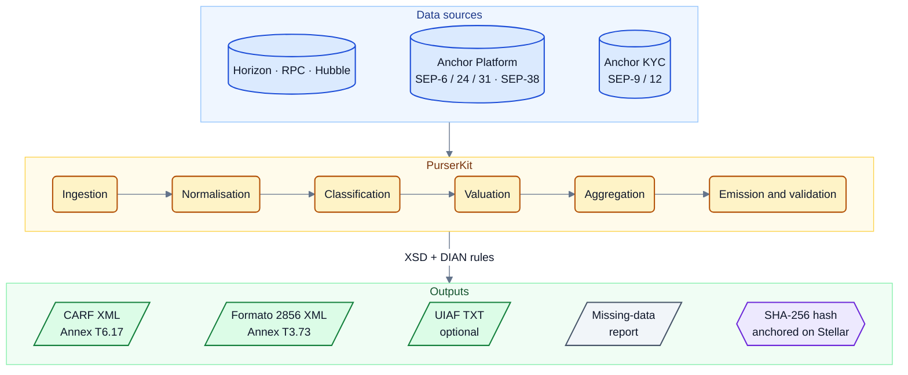

# PurserKit

<p align="center">
  
</p>

<p align="center">🌐 <strong>English</strong> · <a href="README.es.md">Español</a></p>

[](https://github.com/J4rias/PurserKit/actions/workflows/validate.yml)
[](LICENSE)

Open-source toolkit that turns the data of a crypto-asset service provider operating on Stellar (network history and SDF Anchor Platform records) into the regulatory reports required by DIAN (Dirección de Impuestos y Aduanas Nacionales, Colombia's tax and customs authority) and UIAF (Unidad de Información y Análisis Financiero, Colombia's financial intelligence unit).

> The *purser* is the ship's officer in charge of the accounts, the records and the declarations to port authorities. PurserKit plays that role for a Stellar anchor.

> [!NOTE]
> **Status: prototype.** The bundled examples validate against the official schemas; the library and CLI are under development. Every document in this repository is available in English and Spanish; use the 🌐 language switcher at the top of each file.

---

## Contents

1. [Reports covered](#reports-covered)
2. [Why it exists](#why-it-exists)
3. [How it works](#how-it-works)
4. [Repository layout](#repository-layout)
5. [Quick start](#quick-start)
6. [Data model](#data-model)
7. [Asset classification](#asset-classification)
8. [Data sources and retention](#data-sources-and-retention)
9. [Roadmap](#roadmap)
10. [Out of scope](#out-of-scope)
11. [Privacy and security](#privacy-and-security)
12. [Contributing](#contributing)
13. [Disclaimer](#disclaimer)
14. [License](#license)

---

## Reports covered

| Report | Regulation | Format | Frequency | First deadline |
|---|---|---|---|---|
| **CARF** (OECD Crypto-Asset Reporting Framework, automatic exchange of information) | DIAN Resolution 000240 of 2025, Technical Annex T6.17 "CARF XML v1.5" | UTF-8 XML, OECD schema v1.5, one file per jurisdiction | Annual | 31 May 2027 (tax year 2026) |
| **Formato 2856** — Report of operations with digital assets (third-party information, *exógena*) | DIAN Resolution 000233 of 2025, art. 1.3.12.21, Technical Annex T3.73 | ISO-8859-1 XML, DIAN's own schema, max. 5,000 records per file | Annual | 2027 *exógena* calendar (tax year 2026) |
| **UIAF** — transaction and customer reports for virtual-asset service providers *(stretch goal)* | UIAF Resolution 314 of 2021 and its current technical annexes | Pipe-delimited TXT, ANSI CP1252 | Monthly (days 1–20) | In force since July 2022 |

Each obligation is summarised in [`docs/legal-framework.md`](docs/legal-framework.md); the Formato 2856 specification is in [`docs/formato-2856.md`](docs/formato-2856.md).

## Why it exists

- Both DIAN reports cover the same tax year with different schemas. Generating them from a single data source avoids inconsistencies between them.
- The SDF Anchor Platform records SEP-6, SEP-24 and SEP-31 transactions, but it does not persist customer identification data (which lives in the anchor's own server via SEP-12) and offers no regulatory export.
- Stellar's KYC field standard (SEP-9) has no fields for tax residence, multiple tax identification numbers or self-certification, all of which CARF requires.
- A file with errors, or one that does not match what was requested, triggers the penalties of article 651 of the Colombian Tax Code (up to 7,500 UVT).
- Commercial CARF reporting tools do not cover the Colombian formats and do not confirm Stellar support.

## How it works



1. **Ingestion.** Reads the Anchor Platform tables (`sep6_transaction`, `sep24_transaction`, `sep31_transaction`, `exchange_quote`), the anchor's KYC (SEP-9 fields) and on-chain history (Horizon for recent data; CAP-67 events via RPC; Galexie or Hubble for backfill).
2. **Normalisation.** Every movement becomes a reportable event: user, asset, units, direction (in/out), counterparty type, fiat leg if any, timestamp and source reference.
3. **Classification.** A rules table assigns each event to a CARF category (fiat↔crypto, crypto↔crypto, transfers by type, transfers to unhosted wallets, retail payments) and to a Formato 2856 operation type. See [`docs/stellar-carf-mapping.md`](docs/stellar-carf-mapping.md).
4. **Valuation.** Price at the time of the operation, in this order of preference: the anchor's own SEP-38 quote, the Stellar DEX price, an external aggregator. Conversion to COP uses the official TRM exchange rate published on datos.gov.co. Every price used is logged for audit.
5. **Aggregation.** Totals per user × asset × category, as both formats require.
6. **Emission and validation.** The XML files are generated and validated against the official XSDs and DIAN's additional rules (identifier lengths, NIT without check digit, decimals, encoding, file partitioning). Corrections and deletions (CARF702) and nil reports (CARF703) are supported.
7. **On-chain audit trail.** The SHA-256 hash of every generated file is anchored on Stellar through a `manage_data` entry on the provider's account, so it can be proven which file was prepared and when, without exposing its content.
8. **Missing-data report.** Before emission, users without a tax identification number, tax residence or self-certification are listed so the compliance team can complete them.

## Repository layout

| Path | Contents |
|---|---|
| `prototype/proto.py` | Read-only prototype: queries public mainnet accounts via Horizon, classifies operations into CARF categories, values them in COP with the TRM and emits XML with synthetic identities. |
| `examples/carf_proto_COP.xml` | Sample CARF report valued in COP, generated by the prototype. Validates against the official XSD. |
| `examples/carf_proto_USD.xml` | Same report valued in USD. |
| `examples/carf_nil_CARF703.xml` | Nil report (CARF703) with identifiers in the format DIAN requires. |
| `schemas/dian-t6.17-carf-v1.5/` | Annex T6.17 XSDs (`CARFXML_v1.5.xsd`, `oecdcarftypes_v5.0.xsd`, `isocarftypes_v1.1.xsd`) and their provenance. |
| `schemas/dian-t3.73-formato-2856/` | Provenance of the Formato 2856 XSD (extraction from the annex pending). |
| `docs/legal-framework.md` | Summary of the DIAN and UIAF obligations. |
| `docs/stellar-carf-mapping.md` | Mapping between Stellar operations/events and CARF categories. |
| `docs/formato-2856.md` | Formato 2856 specification and its mapping from the data model. |
| `tests/README.md` | Planned test cases for both schemas. |
| `.github/workflows/validate.yml` | Continuous integration: validates the examples against the XSD on every push. |

## Quick start

Requirements: Python 3.10 or later, `libxml2-utils` (for `xmllint`).

```bash
# 1. Validate the examples against the official schema
xmllint --noout --schema schemas/dian-t6.17-carf-v1.5/CARFXML_v1.5.xsd examples/*.xml

# 2. Install the prototype's dependency
python3 -m venv .venv && source .venv/bin/activate
pip install lxml

# 3. Run the prototype (public APIs only, no credentials)
cd prototype
python3 proto.py
```

The prototype writes `carf_proto_COP.xml`, `carf_proto_USD.xml` and `events_sample.json` to the current directory and prints, per account, the number of classified operations, the totals per category and the result of the DIAN rule checks.

## Data model

The central element is the **reportable event**:

| Field | Description |
|---|---|
| `user_id` | Customer identifier in the anchor's system (join key to the KYC) |
| `asset` | Asset code and issuer (`USDC:GA5Z…`, `native`, SAC contract) |
| `units` | Amount in asset units (up to 7 decimals) |
| `direction` | `in` / `out` relative to the user |
| `counterparty_type` | `self`, `vasp`, `unhosted`, `issuer`, `unknown` |
| `fiat_leg` | Fiat amount and currency when the operation has a fiat side (deposits and withdrawals) |
| `ts` | Ledger close time or anchor transaction timestamp |
| `source_ref` | Transaction hash, SEP transaction id or ledger sequence |

From this event the CARF categories (`CryptoFiatIn/Out`, `CryptoToCryptoIn/Out`, `CryptoTransferIn/Out` with their types, `TransferWallet`, `RRPT`) and the Formato 2856 operation types (1 Purchase, 2 Sale, 3 Exchange for goods or services, 4 Exchange for other digital assets, 5 Donations and/or rewards) are derived.

## Asset classification

CARF excludes central bank digital currencies and specified electronic money products from reporting. Whether a given asset is excluded depends on its issuer's regulatory regime and is a decision for the reporting provider and its advisers. PurserKit does not make that decision: it keeps a configurable, versioned **asset registry** in which every asset has a classification and a documented rationale. By default every asset is treated as a relevant crypto-asset (reported).

## Data sources and retention

| Source | Use | Observed retention |
|---|---|---|
| Horizon (`horizon.stellar.org`) | Recent operations, payments, trades and effects | About 13 months |
| Stellar RPC (`getEvents`) | CAP-67 contract and SAC events | About 7 days |
| Galexie / public data lake | Full history for backfill | Complete |
| Hubble (BigQuery) | Analytics and reconciliation at scale | Complete, batch updates |
| Anchor Platform | SEP-6/24/31 transactions and SEP-38 quotes | Per the anchor's database |
| datos.gov.co (`32sa-8pi3`) | Daily TRM exchange rate | Historical since 1991 |

> [!WARNING]
> Horizon's retention (~13 months) is shorter than the annual reporting cycle plus the filing deadline. A provider that starts extracting data close to the deadline will already have lost part of its history. The toolkit is designed to ingest continuously or to rebuild history from the data lake.

## Roadmap

| Phase | Deliverable | Acceptance criteria |
|---|---|---|
| 1 | Library and CLI emitting CARF XML (T6.17) and Formato 2856 XML (T3.73) from the data model | All mandatory elements of both schemas; 30 or more test cases (new, correction, deletion, nil report, natural and legal persons, every transfer type, partitioning into 5,000-record files); 0 validation errors |
| 2 | Stellar operation classifier (12 or more classic types plus SAC events) with COP valuation and price log | 95 % or better agreement on 500 labelled mainnet operations; unit reconciliation against Horizon |
| 3 | Anchor Platform adapter, missing-data report, on-chain anchoring of each file's hash and a SEP-9 extension proposal (tax residences, multiple TINs, self-certification) | Valid end-to-end report from a testnet instance with 50 or more SEP-24/SEP-31 transactions; hashes verifiable in an explorer; proposal published for discussion |

## Out of scope

- Decoding of DeFi protocols (Blend, Soroswap, DeFindex) and liquidity-pool operations.
- Filing the reports with DIAN or UIAF.
- Collecting tax-residence self-certifications from users.
- Hosted or managed service.
- Tax or legal advice.

## Privacy and security

- Designed to run inside the provider's own infrastructure. It sends no data to third-party services and no telemetry.
- Examples and tests use only synthetic identities and public network accounts.
- Personal data processed by the reporting provider is subject to Colombian Law 1581 of 2012; the toolkit does not store it outside the environment where it runs.
- Stellar secret keys are never required to generate reports. On-chain anchoring of the hash is signed with an account designated by the provider.

## Contributing

Contributions are welcome through issues and pull requests. Before opening a PR:

1. Run the example validation (`xmllint`, see [Quick start](#quick-start)).
2. Document any change to the category mapping or the validation rules under `docs/`.

> [!CAUTION]
> Do not include real customer data, production report files or Stellar keys in the repository, not even in branches or issues. Use synthetic identities and testnet accounts only.

## Disclaimer

> [!IMPORTANT]
> PurserKit produces **draft** reports for review by the reporting provider, its statutory auditor or its advisers. It is not tax or legal advice and it is not certified or endorsed by DIAN or UIAF. Interpreting the regulations and deciding to file a report are the sole responsibility of the reporting provider.

## License

Apache License 2.0. See [`LICENSE`](LICENSE).
